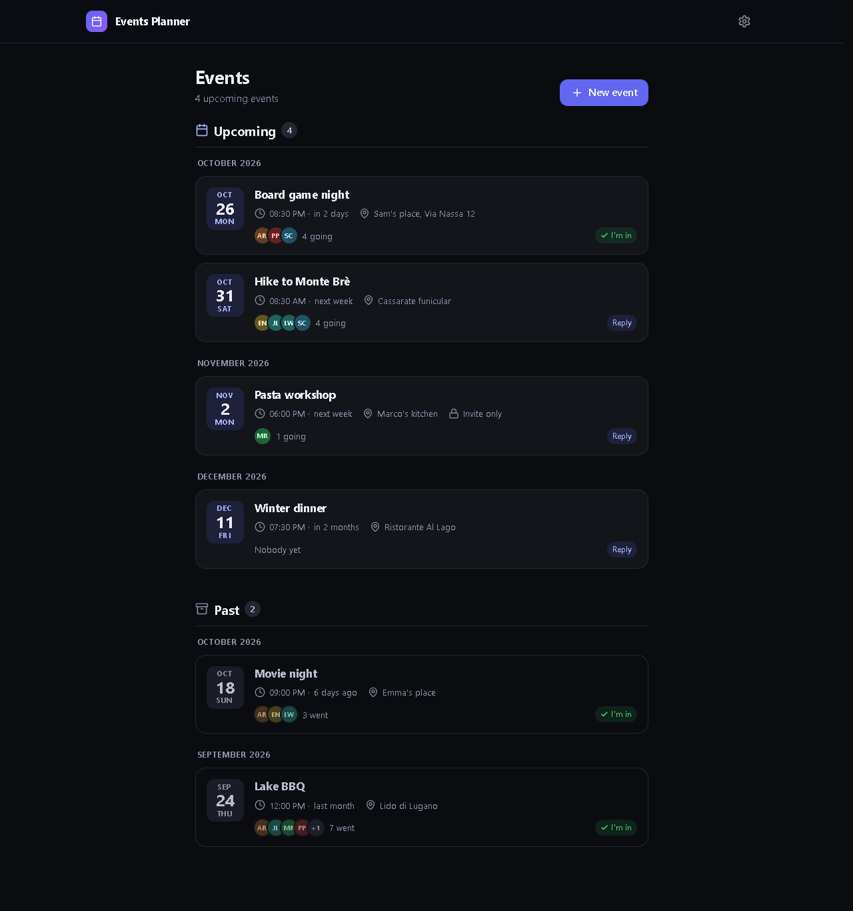
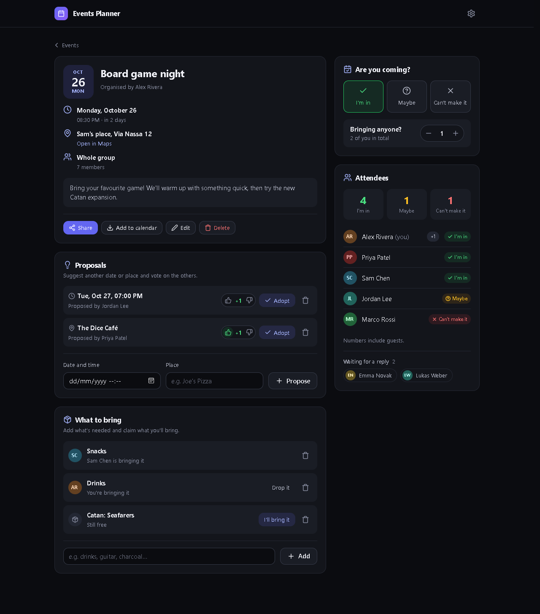
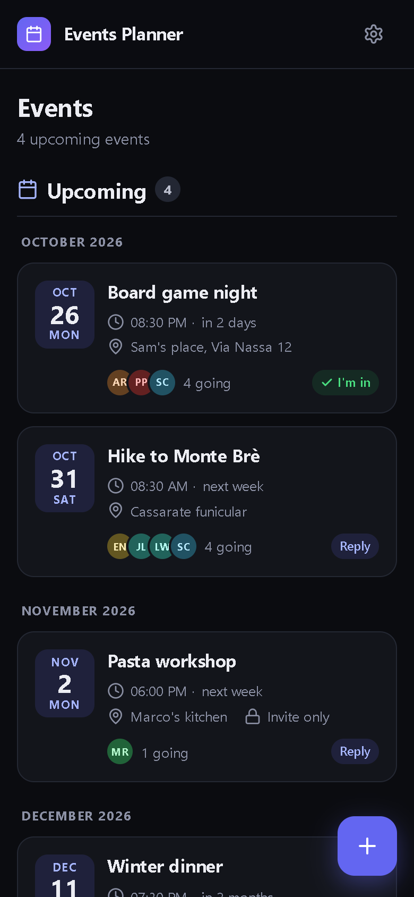
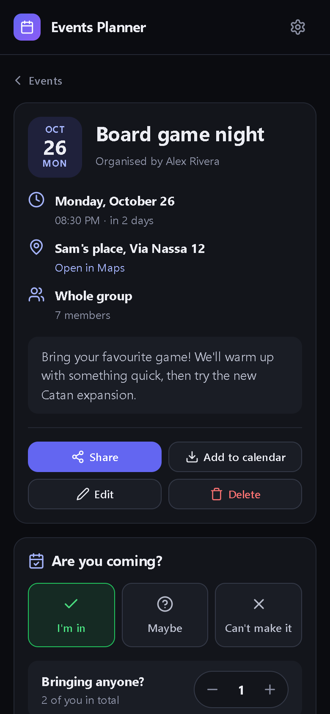

# Events Planner

A small web app to plan a group's events: who's in, who might come, how many guests they bring, alternative dates and places to vote on, and a list of things to bring.

Static vanilla HTML/CSS/JS on GitHub Pages, no build step. [Supabase](https://supabase.com) (free tier) provides Auth, Postgres with Row Level Security, Realtime and two Edge Functions. The UI is in Italian (default) and English, dark theme only, for desktop and mobile.





<p align="center">
  
  
</p>

## Features

- **Invite-only accounts**: users are created by an admin, there is no public sign-up.
- **RSVP**: _I'm in / Maybe / Can't make it_, plus guests, and a list of who hasn't replied yet.
- **Audience**: an event is for the whole group or only for the people its organizer invites; nobody else can see it.
- **Proposals**: suggest another date or place and vote on it. The organizer or an admin can adopt a proposal, which updates the event and clears the responses.
- **Things to bring**: a shared list where everyone claims what they'll bring.
- **Archive**: 12 hours after it starts an event becomes read-only and moves to the _Past_ section.
- **Real time**: changes from others show up instantly, without losing what you are typing.
- **Sharing**: WhatsApp, Telegram, email, the system share sheet or a link to copy.
- **Calendar**: download a single event as `.ics`, or subscribe to a personal feed with every event you can see (Google, Apple, Outlook).
- **Admin**: create and delete users, reset passwords, grant the admin role.

## Structure

```
web/                          static site (GitHub Pages)
  js/app.js                   router and views
  js/api.js                   Supabase access
  js/i18n.js                  translations and date formatting
  js/ui.js                    escaped html templates, forms, dialogs, icons
supabase/
  migrations/                 schema, RLS and functions, applied in order
  functions/admin-users/      user management (admins only)
  functions/calendar/         personal iCalendar feed
.github/workflows/pages.yml   GitHub Pages deployment
```

## Setup

### Supabase

1. Create a project on [supabase.com](https://supabase.com).
2. Run the files in `supabase/migrations/` in order in the **SQL Editor**, or with the CLI: `supabase link --project-ref <ref>` and `supabase db push`.
3. In **Authentication → Sign In / Providers**, turn off _Allow new users to sign up_ and _Allow anonymous sign-ins_, and set the email _Minimum password length_ to 8.
4. Deploy the Edge Functions, from the dashboard (**Edge Functions → Deploy a new function**, pasting `supabase/functions/<name>/index.ts`) or with the CLI:

    ```sh
    npx supabase functions deploy admin-users --project-ref <ref>
    npx supabase functions deploy calendar --no-verify-jwt --project-ref <ref>
    ```

    `admin-users` keeps _Verify JWT_ on. `calendar` must have it **off**: calendar apps can't log in, so the secret token in the feed URL is the credential.

    Optionally add the `APP_URL` secret (e.g. `https://you.github.io/events-planner/`) to link calendar entries back to the app.

5. Create the first user in **Authentication → Users → Add user** (with _Auto Confirm User_) and make them admin:

    ```sql
    update public.profiles set is_admin = true
    where id = (select id from auth.users where email = 'you@example.com');
    ```

### GitHub Pages

1. In **Settings → Secrets and variables → Actions → Variables** (not _Secrets_), add `SUPABASE_URL` (`https://<ref>.supabase.co`) and `SUPABASE_ANON_KEY` (the `sb_publishable_…` key, public by design).
2. In **Settings → Pages**, set the source to _GitHub Actions_.
3. Push to `main`: the workflow generates `config.js` and publishes `web/`.
4. In Supabase, set **Authentication → URL Configuration → Site URL** to the Pages URL.

### Local development

```sh
cp web/config.example.js web/config.js   # fill in URL and key
npx serve web
```

## Calendar sync

The personal feed is read live on every request: it includes every event you can see, except the ones you declined. Calendar apps poll it on their own schedule, which for Outlook can take over a day. A downloaded `.ics` file is a one-off copy and never updates.

In Outlook, use **Add calendar → Subscribe from web** with the HTTPS link from the account page; Apple Calendar uses the `webcal:` link. If the link is rejected, open it in a private window: it should return a document starting with `BEGIN:VCALENDAR`. A `401 Missing authorization header` means _Verify JWT_ is still on for `calendar`, and a 404 means an invalid token or an undeployed function.

## Security

- RLS is on for every table, and the `anon` role has no privileges. Clients can only update specific columns, never `is_admin` or `created_by`.
- Visibility is defined once, in `event_visible_to()`: group events are visible to everyone, invite-only events to their organizer, invitees and admins. RLS, Realtime and the calendar feed all use it.
- Events and invitees are written only through `save_event()`, which checks permissions and dates. People removed from the invitees also lose their responses, votes and claims.
- Realtime sends deletions to every subscriber with their primary key, so invitations, responses and votes use random surrogate keys that reveal nothing about private events.
- The app also refreshes every 5 minutes while visible, to catch revocations that Realtime cannot deliver.
- Each calendar token has 244 random bits, readable only by its owner; rotating it disables the old link at once.
- The service role key lives only in the Edge Functions, never in the frontend or the repository.
- All of this relies on admins being the only ones who can create accounts, so keep sign-ups and anonymous sign-ins disabled.

## License

[MIT](LICENSE)
